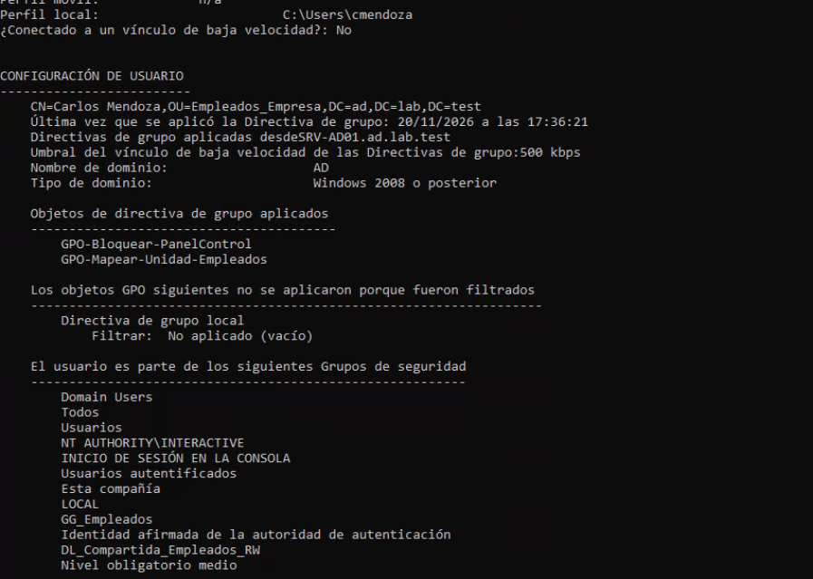
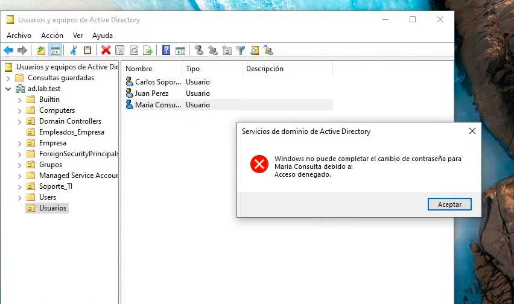
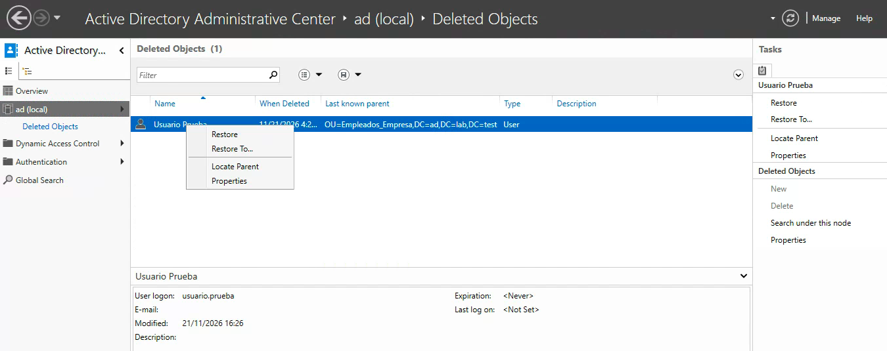

# Administración Avanzada de Active Directory (Windows Server 2022)

Este documento recopila la implementación y validación práctica de gobernanza de accesos (AGDLP), automatización mediante Políticas de Grupo (GPO), delegación de privilegios bajo el principio de mínimo privilegio (RBAC) y recuperación ante desastres mediante la Papelera de Reciclaje de Active Directory en el dominio **`ad.lab.test`**.

--

## 1. Arquitectura del Laboratorio

* **Dominio:** `ad.lab.test` (NetBIOS: `AD`)
* **Controlador de Dominio:** Windows Server 2022 (AD DS, DNS, File Services)
* **Cliente Corporativo:** Windows 10 Pro (unido al dominio, con herramientas RSAT instaladas)
* **Estructura Organizativa (OUs):**
  * `Empleados_Empresa`: Usuarios estándar y departamentos operativos.
  * `Soporte_TI`: Cuentas y grupos técnicos de soporte (Helpdesk Nivel 1).

---

## 2. Control de Acceso a Recursos Compartidos (Modelo AGDLP)

Para escalar la administración de permisos en carpetas compartidas sin asignar derechos individuales a usuarios, se aplicó la metodología estándar **AGDLP** (*Accounts $\rightarrow$ Global Groups $\rightarrow$ Domain Local Groups $\rightarrow$ Permissions*):

1. **Accounts (A):** Cuentas de usuario finales ubicadas en la OU `Empleados_Empresa`.
2. **Global Group (G):** Grupo de seguridad global `GG_Empleados` que agrupa a los empleados por rol/departamento.
3. **Domain Local Group (DL):** Grupo de seguridad local de dominio `DL_Compartida_Empleados_RW` creado específicamente para gestionar el acceso de lectura/escritura sobre el recurso compartido.
4. **Permissions (P):** Asignación de permisos NTFS (`Modificar`) y de recurso compartido a `DL_Compartida_Empleados_RW`, anidando `GG_Empleados` dentro de este grupo.

---

## 3. Mapeo Automático de Unidades mediante GPO (Drive Maps)

Se configuró una Política de Grupo vinculada a la OU `Empleados_Empresa` mediante *Group Policy Preferences* para montar automáticamente el recurso de red como unidad **`Z:`** al iniciar sesión.

### Comandos de aplicación y auditoría en cliente Windows 10

```cmd
:: Forzar la actualización inmediata de políticas de equipo y usuario
gpupdate /force

:: Auditar las GPO aplicadas y pertenencia a grupos de seguridad del usuario
gpresult /r
```

* **Evidencias de despliegue:**




---

## 4. Delegación de Control (Principio de Mínimo Privilegio / RBAC)

Para evitar el uso de cuentas *Domain Admins* en tareas cotidianas de soporte técnico, se implementó delegación granular sobre la OU `Empleados_Empresa`:

* **Identidad delegada:** Usuario `soporte.n1` (ubicado en `Soporte_TI`) miembro del grupo global `GG_Helpdesk_N1`.
* **Alcance de la delegación:** Exclusivamente sobre la OU `Empleados_Empresa`.
* **Permisos concedidos:**
  * Restablecer contraseñas de usuario y forzar el cambio en el siguiente inicio de sesión.
  * Leer toda la información de usuario.
* **Permisos denegados por diseño:** Eliminación de cuentas, modificación de GPO y administración de objetos fuera de `Empleados_Empresa`.

### Validación desde cliente Windows 10 con RSAT

Instalación de herramientas administrativas de AD DS en Windows 10 Pro:

```powershell
Add-WindowsCapability -Online -Name "Rsat.ActiveDirectory.DS-LDS.Tools~~~~0.0.1.0"
```

Ejecución de la consola *Usuarios y equipos de Active Directory* bajo contexto delegado:

```cmd
runas /user:ad.lab.test\soporte.n1 "mmc C:\Windows\System32\dsa.msc"
```

*(Nota técnica: En el Controlador de Dominio, el inicio de sesión interactivo local está restringido por seguridad para cuentas no administrativas; para pruebas locales en el servidor se emplea el modificador `/netonly`).*

* **Resultados de las pruebas de seguridad:**
  * Restablecimiento de contraseña de usuarios dentro de `Empleados_Empresa`: **Permitido**.
  * Eliminación de usuarios dentro de `Empleados_Empresa`: **Acceso denegado**.
  * Gestión de cuentas fuera de `Empleados_Empresa` (ej. contenedor `Users`): **Acceso denegado**.
  * Gestión de cuentas fuera de `Empleados_Empresa` (ej. contenedor `Users`): **Acceso denegado**.



---

## 5. Recuperación ante Desastres: Papelera de Reciclaje de AD

Se habilitó la característica opcional **Recycle Bin Feature** a nivel de bosque desde el *Centro de administración de Active Directory* (`dsac.exe`) / PowerShell, permitiendo restaurar objetos eliminados accidentalmente conservando su **SID**, atributos y pertenencia previa a grupos de seguridad (`GG_Empleados`).

### Comandos PowerShell de gestión y recuperación

```powershell
# Habilitar la Papelera de Reciclaje de Active Directory en el bosque
Enable-ADOptionalFeature -Identity 'Recycle Bin Feature' -Scope ForestOrConfigurationSet -Target 'ad.lab.test' -Confirm:$false

# Consultar objetos eliminados actualmente en el contenedor Deleted Objects
Get-ADObject -Filter 'isDeleted -eq $true -and Name -ne "Deleted Objects"' -IncludeDeletedObjects | Select-Object Name, LastKnownParent

# Restaurar un usuario eliminado con todos sus atributos y grupos intactos
Get-ADObject -Filter 'Name -like "Usuario Prueba*"' -IncludeDeletedObjects | Restore-ADObject.




```
