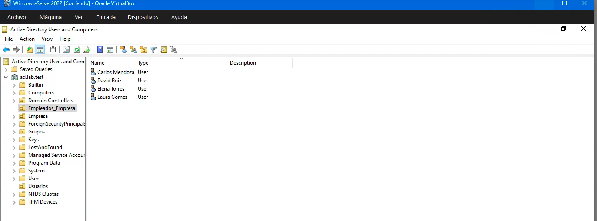
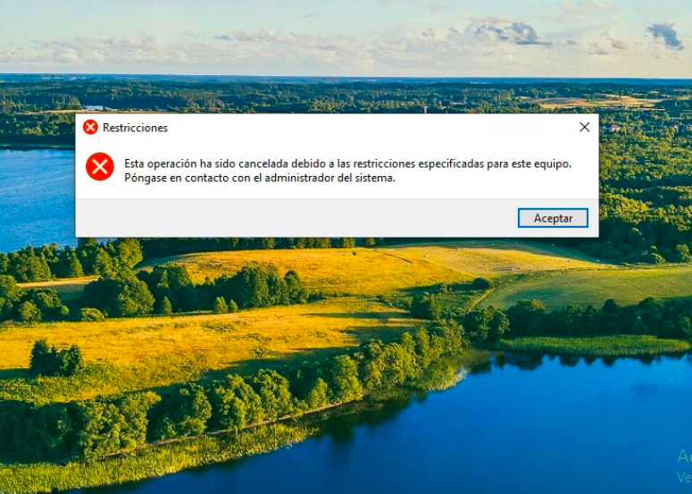
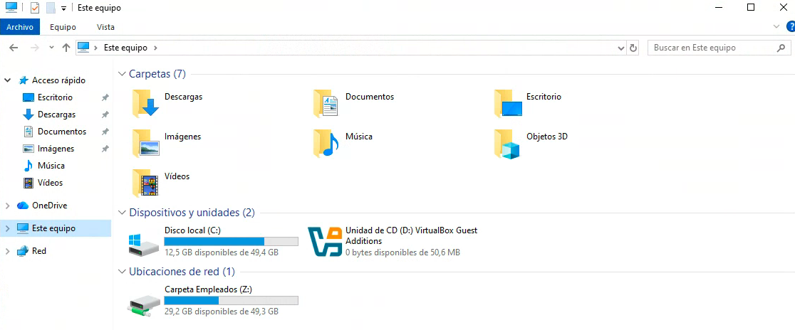

# Windows Server 2022 Active Directory Homelab

Implementación de una infraestructura de dominio empresarial utilizando Windows Server 2022 y un cliente Windows 10.

## Arquitectura y Servicios

* **Dominio Active Directory:** `ad.lab.test`
* **Controlador de Dominio:** Windows Server 2022 (AD DS + DNS).
* **Cliente:** Windows 10 Pro unido al dominio.
* **Automatización:** Aprovisionamiento masivo de usuarios mediante PowerShell.
* **Seguridad:** Gestión centralizada mediante Políticas de Grupo (GPO).

## Automatización con PowerShell
El script [`crear-usuarios.ps1`](scripts/crear-usuarios.ps1) automatiza la creación de la Unidad Organizativa `Empleados_Empresa` y da de alta 4 cuentas de usuario estándar.

## Políticas de Grupo (GPO) Implementadas
1. **Restricción de Panel de Control (`GPO-Bloquear-PanelControl`):** Aplicada a nivel de OU para evitar cambios no autorizados por parte de los usuarios.
2. **Endurecimiento de Contraseñas:** Aplicada a nivel de dominio exigiendo complejidad y un mínimo de 10 caracteres.

## Estructura del Repositorio

* `README.md`: Documentación principal del laboratorio.
* `img/`: Capturas de pantalla de la configuración y pruebas.
* `scripts/crear-usuarios.ps1`: Script en PowerShell para la creación masiva de usuarios.

## Comandos de Verificación

* **Listar los usuarios creados en Active Directory (PowerShell en el servidor):**
  `Get-ADUser -Filter * -SearchBase "OU=Empleados_Empresa,DC=ad,DC=lab,DC=test" | Select-Object Name, SamAccountName, Enabled`

* **Forzar y auditar las GPO aplicadas (CMD en el cliente Windows 10):**
  `gpupdate /force` y `gpresult /r`

  ## Recursos Compartidos y Modelo AGDLP

* **Cadena AGDLP aplicada:** Cuentas de usuario en `Empleados_Empresa` $\rightarrow$ grupo global `GG_Empleados` $\rightarrow$ grupo local de dominio `DL_Compartida_Empleados_RW` $\rightarrow$ permisos NTFS (`Modificar`) sobre el recurso compartido `Empleados$`.
* **Mapeo automático por GPO:** Política `GPO-Mapear-Unidad-Empleados` configurada en *Drive Maps* para montar la unidad `Z:` al iniciar sesión en el cliente Windows 10 (previo cierre y reapertura de sesión para refrescar el token de grupo).

* 

* 
